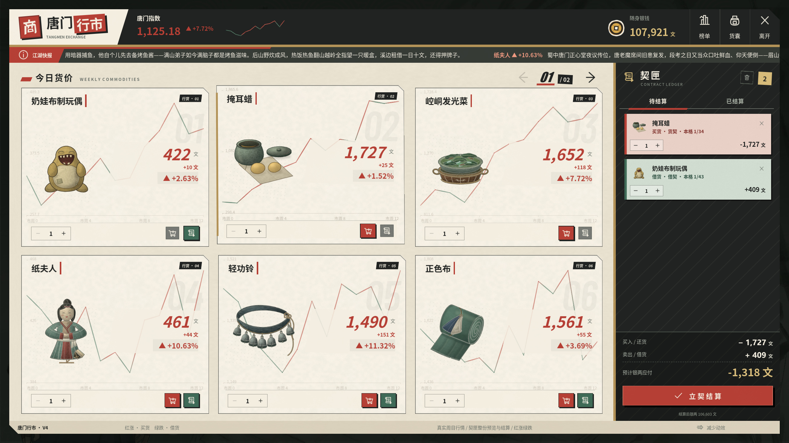
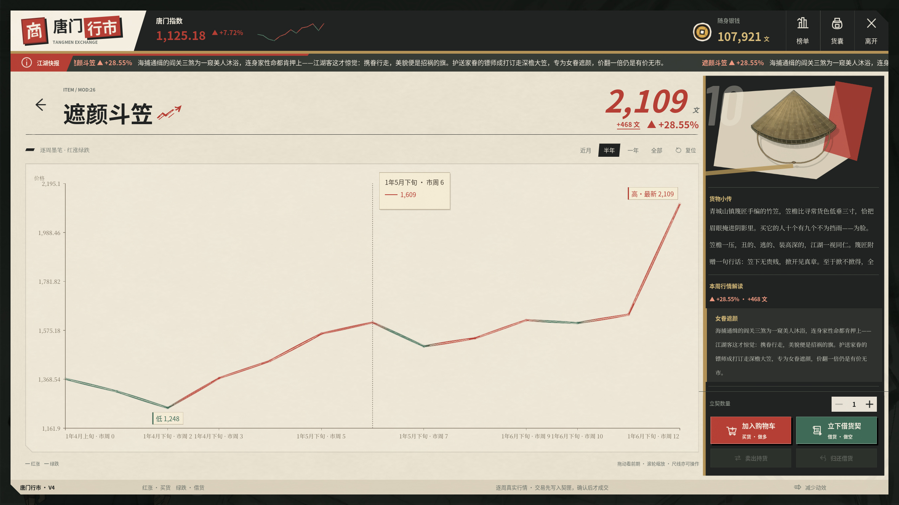
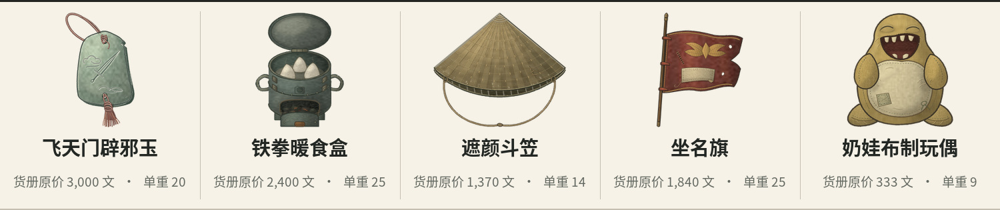
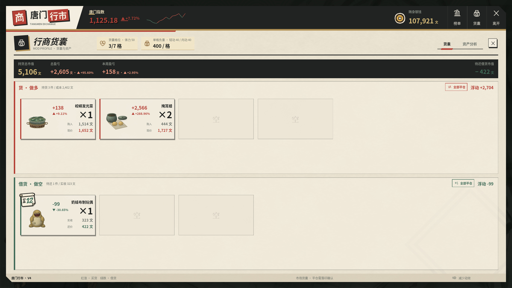
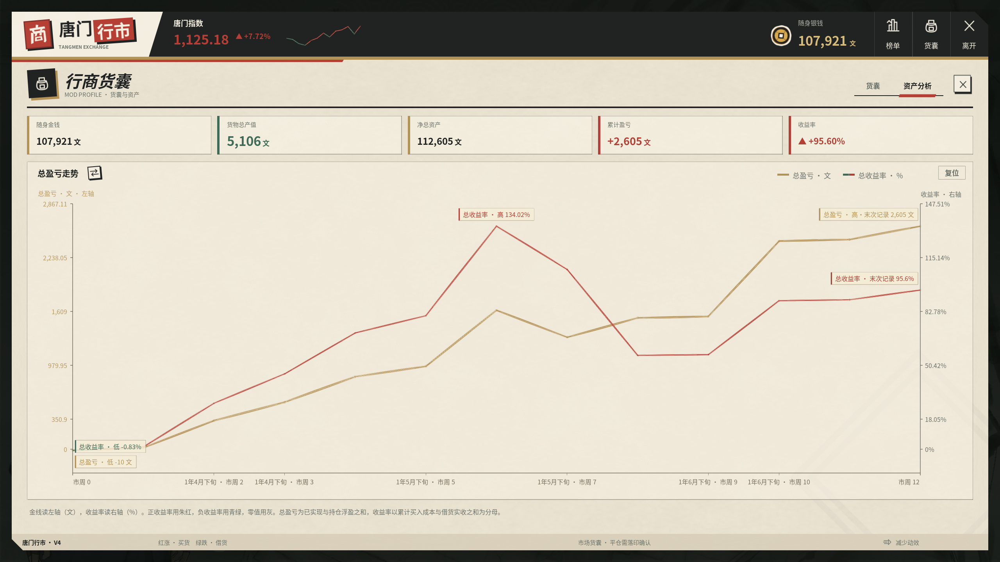

# 唐门行市

**在《活侠传》里，用赵活的银两炒股。** 去唐门大门完成一次「行商」，摊上就会摆出今天的货。看好飞天门辟邪玉，可以买上两件，等涨价再出手。觉得铁拳暖食盒卖贵了，也可以先借来卖，等跌了买回归还。

[下载 Windows 版与安装器](https://github.com/OneWhiteVegetable/LegendOfMortal-TangMenMarket/releases)

## 江湖里的股票市场

货价跟着真实股票和指数的历史周线起伏，随游戏行动逐周推进，全程离线。每个周目都有不同的货物和走势。开局先摆六件，随着唐门壮大，外堡、茶肆等陆续开张，更多货物会从 54 件货样里登场。

点开一件货，就能翻它从开局走到今天的价线。也可以逛逛涨跌榜，读一条江湖快报，再决定这一趟带什么下山。

## 货囊与账本

体力决定货囊有几格，轻功和内功决定每格能背多重。持货和借货共用一个货囊，借来的货还要记得到期日。平时从「系统 → 唐门行市」就能翻看手里的货、它的现价和成本。

这一趟究竟赚了多少？资产分析里可以看总盈亏和收益率，也可以翻看历周的银两和货值。

## 安装

适用于 Windows 64 位版《活侠传》。玩家无需安装 Unity 编辑器。

1. 关闭游戏，在 [版本下载页](https://github.com/OneWhiteVegetable/LegendOfMortal-TangMenMarket/releases) 下载 `XingShangMod-Setup-v2.2.0.exe`。
2. 双击安装器，确认选中含 `Mortal.exe` 的游戏目录，点击「安装 / 更新」。首次装 Mod 的玩家可在这里一并安装 BepInEx 6 Unity Mono x64 前置。
3. 启动游戏，去唐门大门选择「行商」。原版事件结束后，行市自动开启。

已装好前置的玩家也可以下载 `XingShangMod-v2.2.0.zip`，把包里的 `BepInEx` 文件夹解压到游戏根目录。[详细安装、升级与卸载说明](安装说明.txt)
