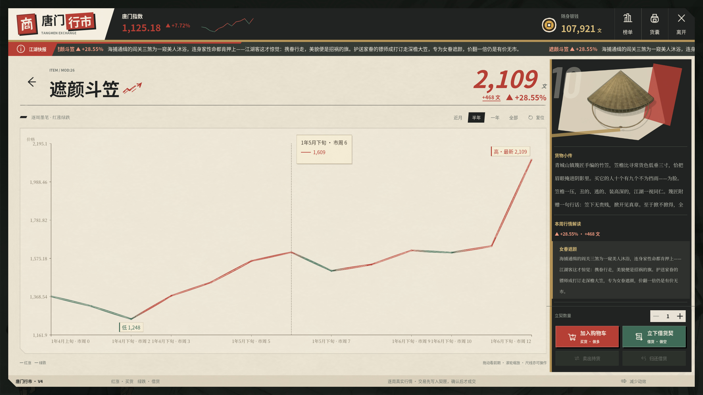
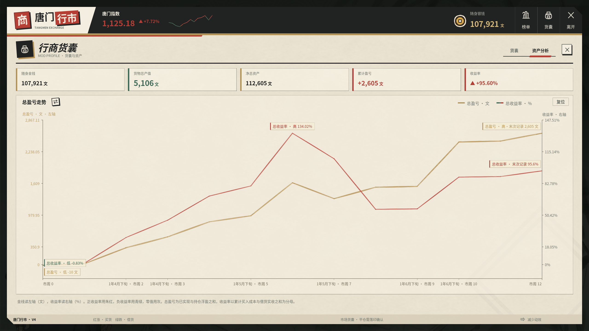

# 唐门行市 v2.2.0

七月门派扩建，一批新货到了。打开新货的详情页，现在也能看到它在四月开局时的身价，以及过去三个月随唐门指数和自身行情走过的每一周。

- **晚解锁商品补齐历史。** 何时抽到哪件货、绑定哪只股票、每周如何计算涨跌都沿用原规则。解锁前货物保持隐藏；旧档里已经公开的报价与成交记录保留。
- **退市股跳过停牌。** 同一游戏市周直接跳过连续无成交记录，复牌延续上次真实收盘价，平价成交周和最终退市照常处理。
- **资产图改用连续墨线。** 总收益率为正时标红，为负时标绿，零值使用中性色。标题旁的斜方形双箭头切换盈亏走势与资产留痕。
- **新增 Windows 安装器。** 识别 Steam 目录，也可手选游戏根目录。已安装 BepInEx 6 Unity Mono x64 时可以离线安装或升级；另提供手动 ZIP。

附件中 `XingShangMod-Setup-v2.2.0.exe` 是双击安装器，`XingShangMod-v2.2.0.zip` 是插件包，两种方式任选其一。两个文件各附一份对应的 SHA256。
